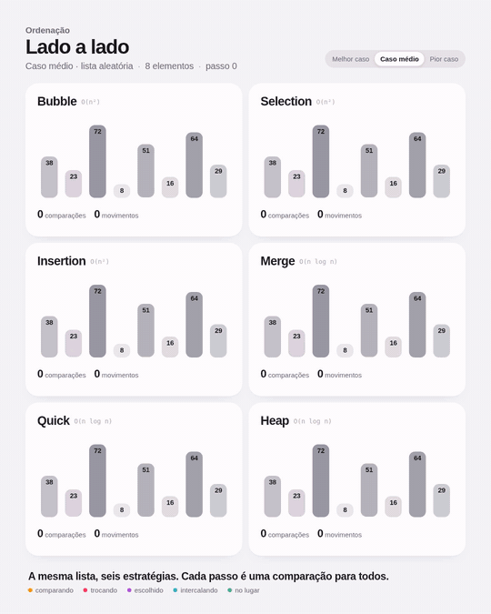
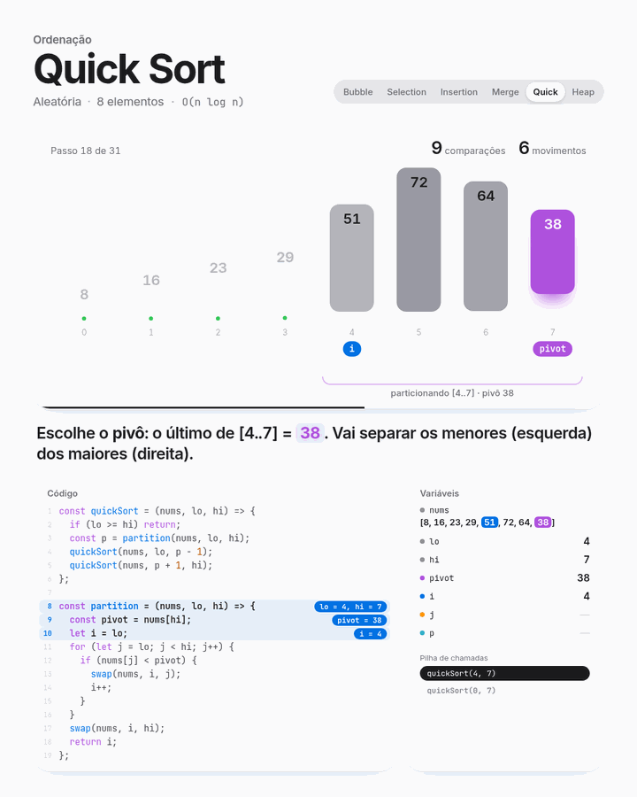
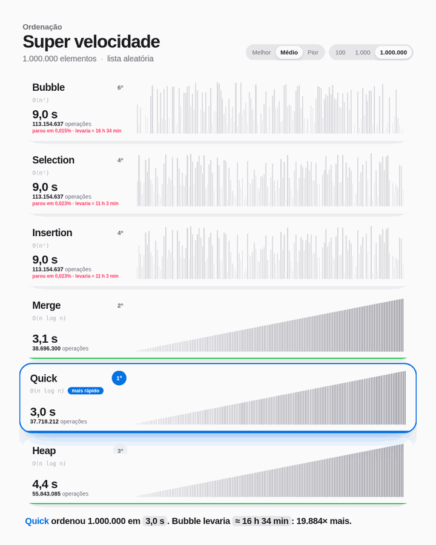
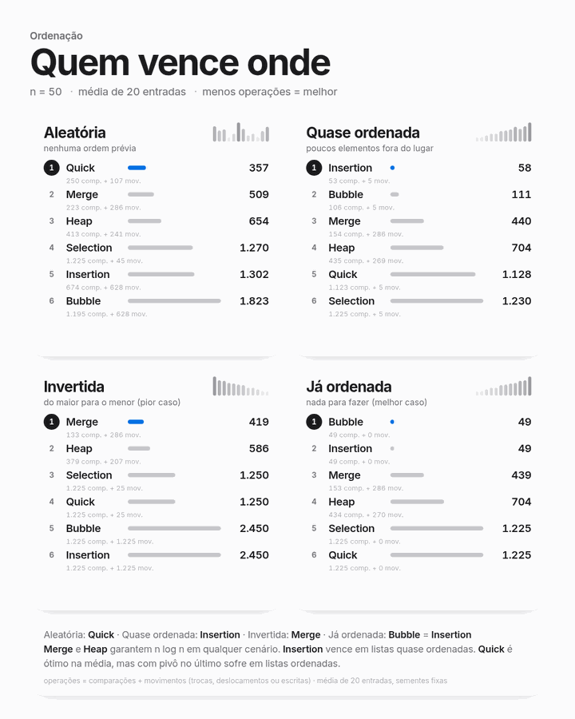

<div align="center">


# AlgoView

**Algoritmos que você vê funcionar.**

Simuladores interativos de ordenação e busca: o código linha a linha, comparações lado a lado
e 1 milhão de elementos em super velocidade. Feito com HTML, CSS e JavaScript puros.

[**Abrir o AlgoView →**](https://moises-paschoalick.github.io/algoview/)

<br />



<sub>Bubble, Selection, Insertion, Merge, Quick e Heap Sort ordenando a mesma lista. Cada passo é uma comparação para todos.</sub>

</div>

## Simuladores

| | Simulador | O que mostra |
|---|---|---|
| ⭐ | [**Laboratório de Algoritmos**](https://moises-paschoalick.github.io/algoview/laboratorio.html) | 6 ordenações e 4 buscas em um só lugar (detalhes abaixo) |
| | [Busca Binária](https://moises-paschoalick.github.io/algoview/busca-binaria.html) | passo a passo com `low`, `mid` e `high`, O(log n) |
| | [Max Consecutive Ones](https://moises-paschoalick.github.io/algoview/max-consecutive-ones.html) | maior sequência de 1s em uma passada, O(n) |
| | [Fibonacci](https://moises-paschoalick.github.io/algoview/fibonacci.html) | recursão exponencial O(2ⁿ) × linear O(n), com gráfico |
| | [Corrida de Ordenação](https://moises-paschoalick.github.io/algoview/corrida-ordenacao.html) | 4 ordenações em pistas paralelas (tema escuro) |
| | [Corrida de Buscas](https://moises-paschoalick.github.io/algoview/corrida-buscas.html) | 4 buscas procurando o mesmo valor (tema escuro) |

## O laboratório

<table>
  <tr>
    <td width="33%" valign="top">
      
      <br /><b>Explorar</b><br />
      <sub>O código com a linha atual em destaque, todas as variáveis, os laços e a pilha de chamadas.</sub>
    </td>
    <td width="33%" valign="top">
      
      <br /><b>Super velocidade</b><br />
      <sub>100, 1.000 e 1.000.000 de elementos no mesmo ritmo: o Quick termina em 3 s, o Bubble levaria 16 h.</sub>
    </td>
    <td width="33%" valign="top">
      
      <br /><b>Ranking por cenário</b><br />
      <sub>Quem vence em lista aleatória, quase ordenada, invertida e já ordenada.</sub>
    </td>
  </tr>
</table>

- **Comparar:** os algoritmos lado a lado no melhor, médio e pior caso, com colocação e desempate.
- **Buscas:** sequencial, sequencial ordenada, binária e binária recursiva na mesma lista.
- **Som:** cada comparação, troca e chegada tem um som sintetizado na hora.
- **Para gravar:** palco 4:5 (1080 × 1350), roteiros automáticos e modo sem controles.

### Atalhos

| Tecla | Ação | Tecla | Ação |
|---|---|---|---|
| `Espaço` | play / pausa | `C` | roteiro de comparação |
| `→` | próximo passo | `X` | roteiro super velocidade |
| `R` | recomeçar | `B` | roteiro de buscas |
| `Ctrl` `+` / `−` | zoom | `M` | liga / desliga o som |
| `O` | painel de opções | `H` | oculta os controles |

## Rodar localmente

Não precisa instalar nada. Abra o `index.html` no navegador ou sirva a pasta:

```bash
python3 -m http.server 8000
# http://localhost:8000
```
